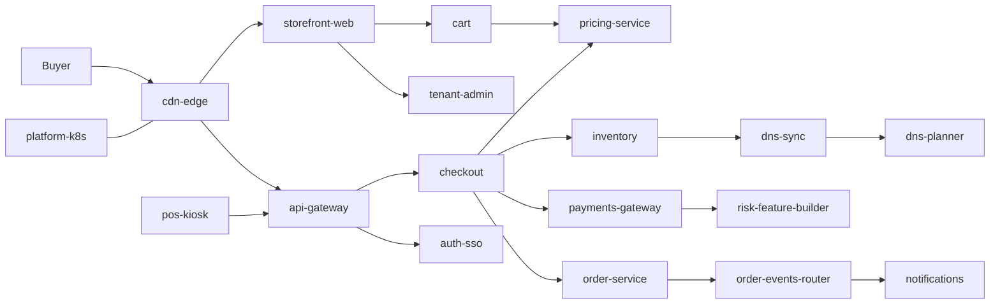

<!-- Synthetic demo code for Nexus Intelligence. Not a real system. -->

# Orbit Commerce

> **Synthetic demo.** This repository is fictional product code for demonstrations. It contains no real customer, company, or personal data. Hostnames use `*.example` (and the internal zone `*.orbit.internal`). Do not treat logs, tenants, or prices here as production data.

Orbit Commerce is a multi-tenant B2B and B2C commerce platform. Merchants get a storefront, a cart, pricing (including B2B contracts), checkout, card authorisation, and order events. The synthetic footprint is about 2,400 merchants across three regions: `us-east`, `eu-west`, and `ap-south`.

## Service map

## Data flow

1. A buyer opens a merchant host such as `shop.northwind.example`. `cdn-edge` (edge proxy and WAF) evaluates the rules bundle. `storefront-web` resolves the host to a tenant in `tenant-admin`.
2. The storefront reads `catalog` and `search`, then writes a `cart`.
3. Cart totals call `pricing-service` (span `pricing.quote`). B2B prices can also be applied later on the legacy order-router.
4. `checkout` (`checkout.place_order`) reserves stock at `inventory.svc.orbit.internal`, authorises the card at `payments-gateway` (`payments.authorize`, which calls `risk.score`), and submits an order.
5. `order-service` stores the order. On the order-router fleet the flag `ENABLE_BULK_REPRICE` selects the B2B pricing path.
6. `order-events-router` fans `order.created` out (`router.fanout`) to merchant webhooks and to `notifications` (`webhook.deliver`, confirmation email).
7. `dns-planner` publishes desired endpoint records. `dns-sync` workers apply them. `platform-k8s` is the node image and Cilium CNI those pods run on. `pos-kiosk` is the in-store Orbit POS app; it starts only after the operating system has a session.

## Layout

Each service is a top-level directory. Versions live in that directory's `VERSION` file. `make check` compiles the C, Rust, and Java sources, checks the Ansible recap helper, and runs the Node tests.

`docs/incident-map.md` maps synthetic tickets NEX-27 through NEX-35 onto the services, functions, config keys, and commits in this repo. Those commits are the history of this branch. The change refs named in the tickets are repeated in the commit messages because a new repository cannot reuse the original hashes.

## Live demo

`make live` starts a local slice on `127.0.0.1` ports 4400–4414. The storefront is http://127.0.0.1:4401 and the observability API is http://127.0.0.1:4400. `make break-nex32`, `make break-nex28`, and `make heal` inject faults. See `live/README.md` and the response contract in `live/API.md`.

## Synthetic banner

Orbit Commerce, its merchants, and its staff are not real. This tree is demo code, not a system anyone can buy from.
